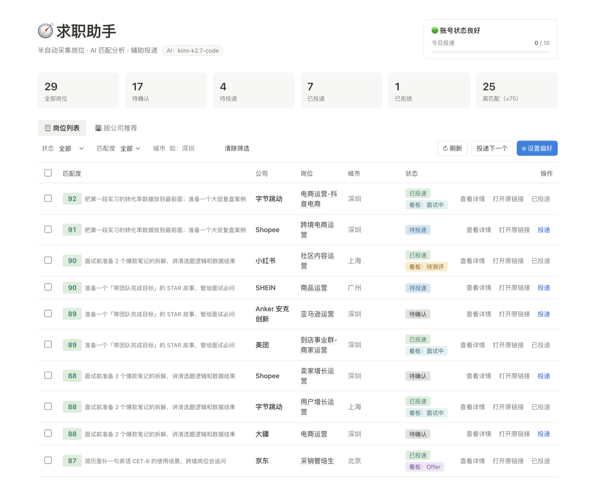
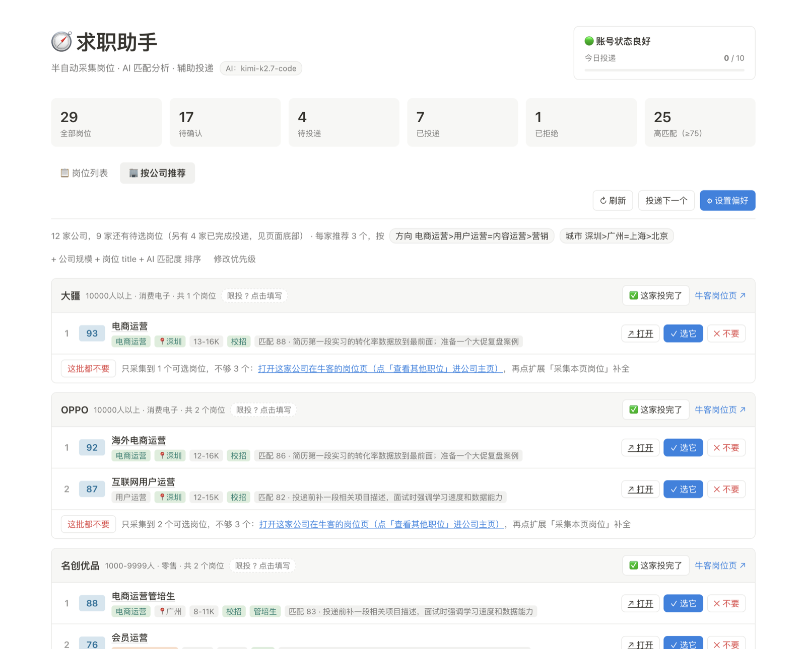
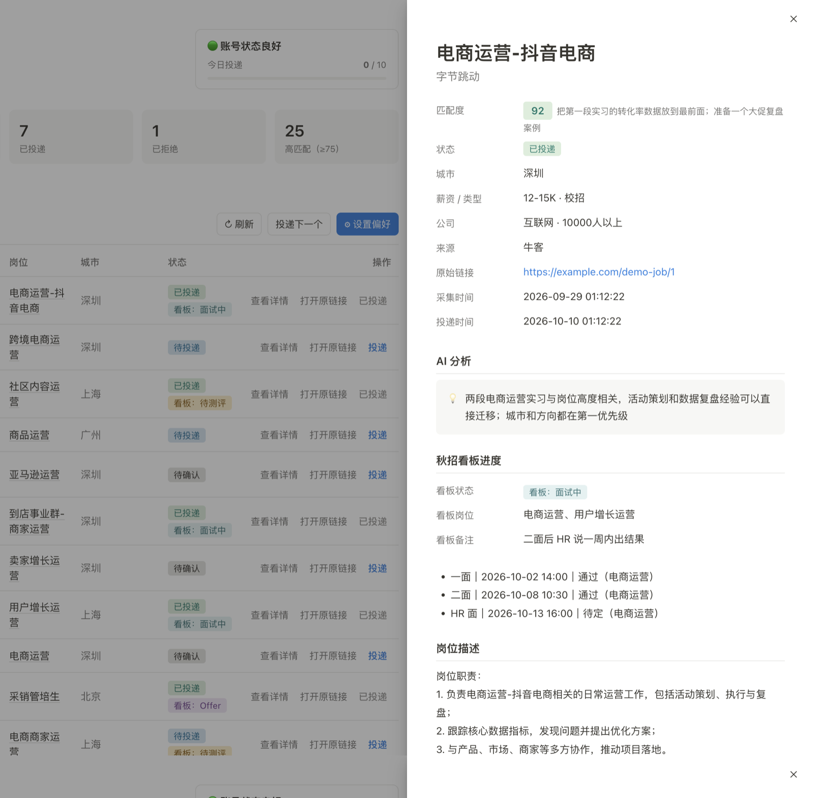
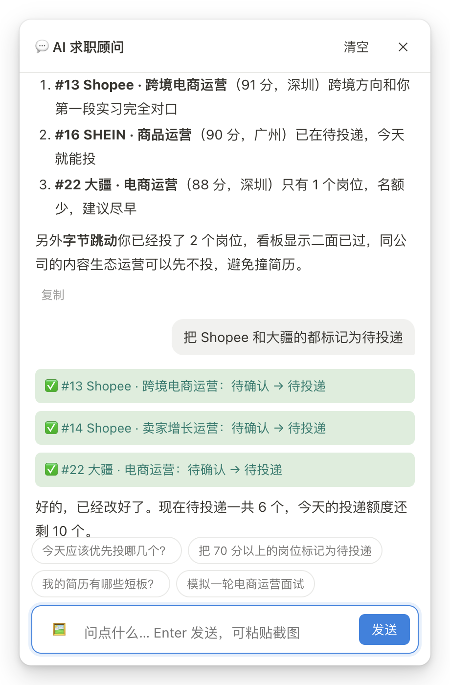

# 🧭 求职助手

半自动的校招求职工具：浏览器扩展采集牛客网岗位 → AI 分析匹配度 → Web 面板筛选、确认、辅助投递。

> 定位是「辅助」而不是「代投」：采集需要你手动点击，投递需要你本人在招聘网站上完成，系统只负责记录和限速。



| 按公司推荐 | 岗位详情（AI 分析 + 看板进度 + 面试记录） |
| --- | --- |
|  |  |

| AI 求职顾问（能直接改数据） | 桌宠「小航」「小招」 |
| --- | --- |
|  |   |

> 截图里的岗位、打分、简历和对话都是 [`demo/seed_demo.py`](demo/seed_demo.py) 生成的虚构数据。

同一套求职工作流里的另外两个项目：

- [qiuzhao-kanban](https://github.com/oxygenxx77/qiuzhao-kanban)：秋招看板，管投递之后的测评、面试、Offer
- [resume-autofill](https://github.com/oxygenxx77/resume-autofill)：网申简历自动填充浏览器扩展

## 功能一览

- **岗位采集**：Chrome / Edge 扩展，在牛客网列表页一键采集公司、岗位、城市、链接、JD 摘要；也支持在岗位详情页采集完整 JD
- **AI 匹配**：调用火山引擎 Ark（OpenAI 兼容协议），按「简历匹配 50% + 岗位偏好 30% + 城市 20%」打分，并给出理由和「值得投 / 谨慎投 / 不建议投」建议
- **黑名单**：命中黑名单公司或岗位关键词直接判 0 分，不消耗 AI 调用
- **AI 求职顾问**：页面右下角「💬 AI 顾问」实时对话，AI 已读过你的简历、偏好和岗位库；在岗位详情点「💬 问 AI」可围绕该岗位的完整 JD 提问（值不值得投、打招呼语、面试题等）。还能直接执行操作，例如「把北京的岗位都标记为拒绝」「目标城市加上广州，每日上限改成 15」「重新分析匹配度」，执行结果以卡片形式显示并自动刷新列表
- **按公司推荐**：面板顶部切到「🏢 按公司推荐」，每家公司按推荐分列出前 3 个岗位（带牛客链接）；点「✕ 不要」后下一个自动补位，「🔄 换一批」看这家公司后面的岗位。推荐分 = AI 匹配 35% + 岗位方向 25% + 城市 20% + 公司规模 12% + 岗位 title 8%，实习 / 社招岗再扣分；方向和城市按偏好里的优先级分档（如「运营>营销=产品」「深圳>广州=上海>北京」），不在优先级里的城市不排除，只是排得靠后
- **辅助投递**：确认岗位 →「投递」打开申请页 → 你手动投完后标记已投递
- **秋招看板联动**：标记已投递的岗位自动同步到秋招看板；看板里的测评 / 面试进度显示在岗位列表和详情中；两边的 AI 互相能看到对方的数据（见下文「秋招看板联动」）
- **风险控制**：每日投递上限，达到上限后拒绝继续标记投递，并记录风险日志
- **兜底策略**：未配置 Key 或 AI 调用失败（自动重试 3 次）时，退化为本地关键词规则估算

## 项目结构

```
job-hunter/
├── backend/
│   ├── main.py          # FastAPI 主服务（同时托管前端页面）
│   ├── database.py      # SQLite 数据库操作（所有 SQL 都在这里）
│   ├── ai_match.py      # AI 匹配分析（重试 + 规则兜底）
│   ├── chat.py          # AI 求职顾问（流式对话 + 工具调用）
│   ├── actions.py       # 投递 / 改状态 / 改偏好等业务操作（网页与 AI 共用）
│   ├── kanban.py        # 秋招看板联动（读写看板的 JSON 数据文件）
│   ├── recommend.py     # 按公司分组推荐（推荐分、公司名归一、AI 估算公司规模）
│   ├── nowcoder.py      # 查询牛客公司校招信息（官网入口、校招公告、网申时间）
│   ├── resume.example.json  # 示例简历（虚构）
│   ├── jobs.db          # SQLite 数据库（首次启动自动生成，不提交）
│   └── resume.json      # 你的简历（从示例复制后修改，不提交）
├── extension/
│   ├── manifest.json    # Manifest V3 配置
│   ├── content.js       # 注入牛客网，识别岗位卡片
│   ├── popup.html
│   └── popup.js
├── frontend/
│   └── index.html       # Web 管理面板
├── desktop-pet/         # macOS 桌宠（Swift / SwiftUI），一键启动两个服务
├── demo/seed_demo.py    # 生成虚构演示数据
├── .env.example         # API Key 配置模板（复制成 .env 再填）
├── requirements.txt
└── README.md
```

`.gitignore` 是白名单式的：默认忽略所有文件，只放行代码、示例和文档，所以简历、岗位库、备份和 `.env` 不会被误提交。

## 快速开始

### 1. 安装依赖

需要 Python 3.9+。

```bash
cd job-hunter
python3 -m venv .venv
source .venv/bin/activate        # Windows: .venv\Scripts\activate
pip install -r requirements.txt
```

### 2. 配置 API Key

复制 `.env.example` 为 `.env` 后编辑：

```ini
OPENAI_API_KEY=你在火山引擎方舟控制台创建的 API Key
OPENAI_BASE_URL=https://ark.cn-beijing.volces.com/api/coding/v3
OPENAI_MODEL=kimi-k2.7-code
```

不填 Key 也能运行，此时使用关键词规则估算匹配度。

### 3. 填写简历

复制 `backend/resume.example.json` 为 `backend/resume.json` 后改成自己的。字段可以自由增加（如项目经历、获奖、证书），整个 JSON 都会发给 AI；`skills` 和 `internships` 还会用于本地规则打分。

### 4. 启动后端

```bash
cd backend
uvicorn main:app --reload --port 8001
# 或者：python main.py
```

- 管理面板：<http://127.0.0.1:8001/>
- 接口文档：<http://127.0.0.1:8001/docs>

**桌宠启动（Mac）**：`bash desktop-pet/build.sh` 会在桌面生成「求职助手.app」（小航）和「秋招看板.app」（小招）。双击后桌面右下角出现小桌宠：单击启动服务并打开页面，悬停看今天的情况，拖动换位置，右键可重启 / 停止服务、看日志。服务日志在 `~/Library/Logs/求职桌宠/`。第一次启动时 macOS 会问能否访问「桌面」文件夹，点「好」。

### 5. 安装浏览器扩展

1. 打开 `chrome://extensions`（Edge 为 `edge://extensions`）
2. 打开右上角「开发者模式」
3. 点击「加载已解压的扩展程序」，选择 `extension` 目录

### 6. 使用流程

1. 在管理面板点击「设置偏好」，填写目标岗位、城市、行业、黑名单、每日上限
2. 打开牛客网校招岗位列表页，**向下滚动**让岗位加载出来（扩展会在后台持续识别滚动加载的岗位）
3. 点击扩展图标 →「采集本页岗位」，弹窗显示「本次采集到 X 个岗位」，识别到的卡片会短暂显示蓝色虚线框
4. 回到管理面板，AI 在后台逐个分析，分数会自动刷新出来
5. 勾选想投的岗位 →「加入待投递」（状态变为「待投递」）
6. 点击「投递下一个」或行内「投递」：打开申请页，你手动完成投递后点「确定」标记为已投递
   - 已经在官网等地方投过的，勾选后点「📮 标记已投递」（批量），或在详情里点「已投过，直接标记」
   - 「按公司推荐」里：已选岗位旁的「✓ 已投递」直接标记单个岗位；公司右上角「✅ 这家投完了」（比如到了限投数）把这家移到底部「已完成投递」栏，没投的待投递岗位退回待确认、不算投递数，看板里还没有这家时补一张「已投递」卡片

岗位状态流转：`pending 待确认` → `approved 待投递` → `applied 已投递`，或 → `rejected 已拒绝`。

### 用演示数据试玩

不想填自己的数据，可以先用虚构数据看效果。脚本只写入你指定的副本目录，目录里已有岗位库或简历时会拒绝运行：

```bash
cp -R job-hunter /tmp/job-hunter-demo
python3 job-hunter/demo/seed_demo.py /tmp/job-hunter-demo
cd /tmp/job-hunter-demo/backend && uvicorn main:app --port 8011
```

秋招看板也有同样的脚本，两个副本通过 `KANBAN_DIR` / `JOB_HUNTER_DB` 环境变量互相指向即可联动。

**按公司拉取全部岗位**：在只有公司卡片的页面（如求职首页「N 个在招职位 / 立即投递」）、岗位列表页或某家公司的主页（`/enterprise/数字`）上，扩展弹窗会出现「本页识别到 N 家公司」。选好类型（只要校招 / 校招 + 实习 / 全部），点「采集这些公司的全部岗位」，扩展会用牛客自己的接口逐家拉取在招岗位（含完整 JD、薪资、规模）。没有公司链接的卡片会按公司名反查。

- 勾选「只要意向方向」时，只保留岗位名或牛客职位类别命中「方向优先级」的岗位（如运营 > 营销 = 产品），其余直接跳过、不入库，避免 AI 分析排长队
- 牛客把多城市的同一职位拆成多条，这里会合并成一条，城市按偏好排序，跳转链接取最想去的城市那条
- 拉取期间请保持弹窗打开；已经采过的岗位不会重复入库，但会补上薪资、公司规模等缺失信息

「按公司推荐」里一家公司岗位不足 3 个时，会给出它的牛客主页链接，打开后用上面的方式补全。公司规模优先用牛客数据，采不到时由 AI 估算（界面上标注「AI 估算」）。

**限投数与网申时间**：每家公司卡片上有
- **网申截止**：从牛客自动查询（每天更新一次），3 天内截止标红，秋招网申已截止的公司排到最后。牛客上只有实习或往年批次信息的会单独注明，不算截止
- **校招公告 / 官网投递** 链接：限投几个、志愿顺序等规则一般写在这里
- **限投数**：牛客不提供，公告也多是长图，所以要自己填——点「限投 ? 点击填写」输入数字（0 = 不限）。填了之后显示「限投 N · 已选 M」，选满后标红，再点「选它」会弹窗确认。「已选」包括待投递和已投递。没有用 AI 估算：实测同一家公司连问两次给出的数字都不一样，不可靠

### 用演示数据试玩

不想填自己的数据时，可以在项目副本里生成一套虚构数据（脚本会拒绝写入已有岗位库或简历的目录）：

```bash
cp -R job-hunter /tmp/job-hunter-demo
python3 job-hunter/demo/seed_demo.py /tmp/job-hunter-demo
cd /tmp/job-hunter-demo/backend && uvicorn main:app --port 8011
```

## API 列表

| 方法 | 路径 | 说明 |
|---|---|---|
| GET | `/api/jobs?status=&min_score=&city=` | 岗位列表，按匹配度降序 |
| POST | `/api/jobs` | 扩展上报岗位，body：`{"jobs": [...], "only_target_roles": false}`，自动去重并触发 AI 分析；`only_target_roles` 为 true 时只收意向方向的岗位 |
| GET | `/api/jobs/{id}` | 岗位详情 |
| POST | `/api/jobs/{id}/status` | 修改状态，body：`{"status": "approved"}` |
| POST | `/api/jobs/batch_status` | 批量修改状态，body：`{"ids": [1,2], "status": "rejected"}` |
| POST | `/api/rematch` | 重新 AI 分析，body：`{"ids": [1,2]}`，不传 ids 则重新分析所有待确认岗位 |
| GET | `/api/preferences` | 读取偏好 |
| POST | `/api/preferences` | 保存偏好（含 `role_priority` / `city_priority` 优先级，不传则保留原值） |
| GET | `/api/recommendations?per_company=3` | 按公司分组推荐，每个岗位附推荐分及各项得分；每家公司附限投数、网申时间、校招公告 / 官网链接 |
| POST | `/api/companies/limit` | 填写某家公司限投几个岗位，body：`{"key": "快手", "apply_limit": 2}`（0 = 不限，null = 清除） |
| GET | `/api/next_approved` | 返回匹配度最高的待投递岗位 |
| POST | `/api/mark_applied/{id}` | 标记已投递（受每日上限约束，超限返回 429） |
| POST | `/api/chat` | AI 顾问对话，body：`{"messages": [{"role": "user", "content": "..."}], "job_id": 12}`，返回 NDJSON 事件流（text / action / error） |
| GET | `/api/risk_status` | 风险状态：green / yellow（≥80% 上限）/ red（达到上限） |
| GET | `/api/stats` | 统计数据 |

## 设计说明

**去重规则**：链接相同，或「公司 + 岗位 + 城市」完全相同，视为同一岗位。扩展会去掉详情链接上的追踪参数，保证同一岗位链接一致。

**匹配度计算**：AI 返回 `resume_score`、`preference_score`、`city_score` 三个子项分数，最终分数由后端按 50% / 30% / 20% 统一加权计算，避免模型自己算错。详情页会展示三个子项分数。

**AI 容错**：网络超时、限流、5xx、返回内容无法解析为 JSON 时，按 2s、4s 退避重试，最多 3 次；鉴权失败、模型不存在这类错误不重试。最终失败时用规则估算兜底，并在风险日志中记录一条「异常」。

**每日上限**：只有通过「投递」标记的岗位计入当日投递数；批量操作不允许直接标记为已投递，避免绕过上限。

## 秋招看板联动

求职助手负责「找岗位、筛岗位」，秋招看板（默认找和本项目并排的 `qiuzhao-kanban` 文件夹，找不到再用 `~/qiuzhao-kanban`）负责「投递后的进度」。两边直接读写对方的数据文件，不需要两个服务同时运行。

| 方向 | 说明 |
| --- | --- |
| 求职助手 → 看板 | 岗位标记为已投递时，看板里没有这家公司就新建一张「已投递」卡片；已有则只把岗位追加到卡片上，不会覆盖看板里的进度 |
| 看板 → 求职助手 | 岗位列表的状态列显示「看板：等结果」等标签（悬停看备注），详情页有「秋招看板进度」区块，含面试记录；「按公司推荐」不再推荐看板里已有的公司，它们收在页面底部「秋招看板里已投递的 N 家公司」折叠区里 |
| 求职助手 AI | 能看到整个看板；推荐岗位时会提醒已投过的公司；说「XX 通知我一面了」会直接更新看板 |
| 看板 AI（小招） | 只读求职助手的 `jobs.db`，能回答「还有什么值得投」，并知道哪些看板公司在求职助手里还有岗位 |

- 公司名会去掉城市前缀和「有限公司 / 集团 / 科技」等后缀再匹配，例如「广州小鹏汽车科技有限公司」对应看板里的「小鹏」。只做单向包含匹配，「腾讯」的岗位不会算到「腾讯音乐」的卡片上
- 写看板前会备份到看板的 `backups/` 目录，并像看板自己一样写入 `history.json`（周报能统计到）
- 端口：**求职助手 8001**，**秋招看板 8000**，两个可以同时开
- 路径可通过环境变量修改：求职助手的 `.env` 里设 `KANBAN_DIR`，看板的 `.env` 里设 `JOB_HUNTER_DB`

## 简历自动填充扩展联动

「简历自动填充」扩展（[resume-autofill](https://github.com/oxygenxx77/resume-autofill)，3.1 版起）在求职助手运行时多出这些功能，求职助手没开时自动隐藏：

- **简历同步**：扩展选项页「保存并同步到求职助手」，把扩展里的简历合并进 `backend/resume.json`（旧文件备份到 `backend/resume_backups/`），之后可选择让 AI 按新简历重新打分。只同步姓名、教育、求职意向、经历、项目、奖项、语言、证书、技能、自我评价；手机号、邮箱、身份证号、住址等不会同步，也就不会发给 AI。技能取并集，某段经历在扩展里没写描述时沿用原来的要点
- **识别岗位**：在网申页打开扩展弹窗，会按网址找到求职助手里对应的岗位；网申页跳到公司官网时，用最近 3 小时内在求职助手点过「投递」的岗位。也可以手动选。会显示匹配分和秋招看板进度，看板里已有该公司时提醒别重复投
- **按岗位填写**：一键填充时「应聘岗位 / 意向城市」按关联的岗位填（岗位名去掉「【2027校园招聘】」之类的后缀，城市优先选你的意向城市）
- **AI 文书**：按岗位 JD 生成自我评价（填充时替换简历里的自我评价）和开放题回答，生成的内容按岗位保存在扩展里
- **标记已投递**：弹窗里点两次「投完了，在求职助手标记已投递」，同时同步到秋招看板
- **填充报告**（3.3 版起）：每次一键填充后，扩展把没填上的字段、填完仍为空的控件发过来，存进 `jobs.db` 的 `fill_reports` 表。汇总接口按「不认识的标签 / 没填上 / 没填满 / 简历里没有」分类，按涉及网站数排序，用来持续补扩展的匹配规则。报告在扩展端已把简历文字换成占位符，入库前再抹一遍手机号、邮箱、身份证号

相关接口：`POST /api/resume/sync`、`GET /api/autofill/context?url=`、`POST /api/autofill/write`、`POST /api/jobs/{id}/apply_intent`；填充报告：`POST /api/autofill/report`、`GET /api/autofill/reports/digest`、`GET /api/autofill/reports`、`POST /api/autofill/reports/resolve`（body：`{"ids": [1,2]}` 或 `{"up_to_id": 9}`）。

## 常见问题

**扩展采集到 0 个岗位？**
牛客页面经常改版，`content.js` 用「详情链接反推卡片 + class 关键词 + 文本行兜底」多重策略识别。如果仍识别不到：先确认页面已滚动加载出岗位；然后在页面 F12 控制台查看 `[求职助手]` 日志，并检查岗位卡片的链接格式和 class 名，补充到 `content.js` 顶部的 `DETAIL_LINK_PATTERNS` / `CARD_SELECTORS` 中。

**扩展提示「无法连接本地服务」？**
确认后端已在 8001 端口启动。修改了扩展代码后需要在扩展管理页点击「重新加载」，并刷新牛客页面。

**修改偏好后分数没变？**
保存偏好时勾选「保存后重新分析待确认岗位」，或者批量选中岗位后点「AI 重新分析」。修改 `resume.json` 后同理。

**使用提醒**：请遵守招聘网站的用户协议，控制采集和投递频率，不要用于大规模抓取。

## 隐私

- 所有数据（简历、岗位库、聊天记录）只存在本机；`resume.json` 会整份发给 AI，所以示例简历里没有联系方式，从扩展同步简历时也不会带上手机号、邮箱、身份证号、住址
- 仓库里的 `.gitignore` 是白名单式的，私人数据文件默认不会进入 git
- 截图和 `demo/` 里的数据全部是虚构的

## 许可证

[MIT](LICENSE)
